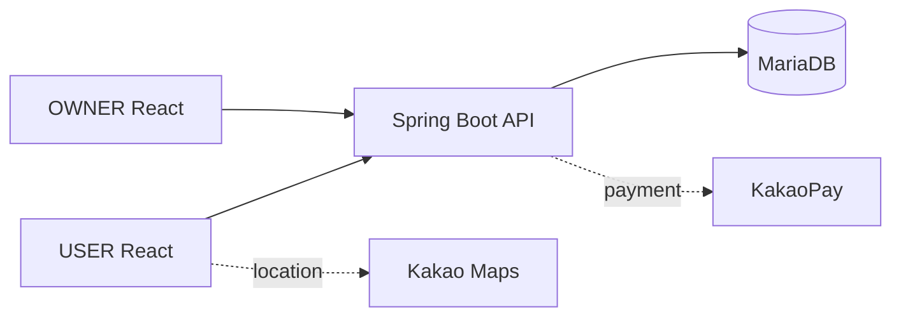

# 뽀득뽀득 — USER 프론트엔드

> 셀프세차장 탐색부터 세차 공간(Bay) 예약·결제·리뷰까지 제공하는 모바일 웹 서비스

[](https://github.com/minjuko/ppodeuk-user-frontend/actions/workflows/ci.yml)


뽀득뽀득은 프론트엔드 3명·백엔드 3명이 개발한 팀 프로젝트입니다.  
저는 **사용자용 프론트엔드의 예약 흐름**을 중심으로 구현했고, 이후 예약·결제 안정성, 회귀 테스트, 실행 환경을 개선했습니다.

## 핵심 사용자 흐름

<table>
  <tr>
    <td width="50%" align="center" valign="top">
      
      <br /><sub>① 지도에서 주변 세차장 탐색</sub>
    </td>
    <td width="50%" align="center" valign="top">
      
      <br /><sub>② 세차장 상세정보 확인</sub>
    </td>
  </tr>
  <tr>
    <td width="50%" align="center" valign="top">
      
      <br /><sub>③ 예약 시간 · 이용 시간 선택</sub>
    </td>
    <td width="50%" align="center" valign="top">
      
      <br /><sub>④ 예약 완료 확인</sub>
    </td>
  </tr>
</table>

## 프로젝트 정보

| 항목 | 내용 |
|---|---|
| 기간 | 2023.09.14–2023.11.17 |
| 형태 | 카카오 테크 캠퍼스 1기 · 6인 팀 프로젝트 |
| 개인 역할 | 사용자용 프론트엔드 예약 흐름 · 세차장 상세·리뷰·지도 UI 일부 |
| 프론트엔드 | React 18 · JavaScript · Redux Toolkit · TanStack Query · Vite |
| 백엔드 | Spring Boot · MariaDB |
| 성과 | 카카오 테크 캠퍼스 1기 신규 서비스 개발 프로젝트 대상 |

## 개인 기여

### 사용자용 프론트엔드

- 세차 공간(Bay) → 날짜 → 시작 시간 → 이용 시간을 순서대로 선택하는 예약 UI와 공유 예약 상태를 구현했습니다.
- 영업시간과 기존 예약을 반영해 선택 가능한 시간 조합만 보여주도록 예약 조건을 연결했습니다.
- 세차장 상세·리뷰·Kakao Map UI 일부와 결제 UI·예약 상태 연결에 참여했습니다.
- 개선 작업에서 예약 시간 계산을 순수 함수로 분리하고, 결제 callback·Loading/Error/Empty State·cache invalidation·keyboard interaction을 보완했습니다.

### 팀 기능과 개인 기여의 경계

- 사업자용 대시보드·매출·세차 공간·예약 관리와 백엔드 원 구현은 개인 담당 범위가 아닙니다.
- 사업자용에서는 세차장 등록 화면의 초기 구조와 일부 입력·공통 UI에 참여했습니다.
- 백엔드는 원 개발 담당이 아니며, 이후 로컬 실행 환경과 사용자용 프론트엔드 연동 검증을 보완했습니다.

## 핵심 설계

### 예약 조건의 종속 상태를 명확히 관리

상위 조건이 바뀌면 하위 선택값을 초기화해 이전 선택이 다음 요청에 남지 않게 했습니다.

```text
세차 공간(Bay) → 날짜 → 시작 시간 → 이용 시간 → 예약·결제
  변경 시 종속 선택값 초기화
```

시간 규칙은 UI에서 분리해 영업시간, 30분 단위 slot, 이용 시간, 기존 예약의 겹침과 자정 경계를 회귀 테스트로 고정했습니다.

### 상태 성격에 따라 Redux Toolkit과 TanStack Query를 분리

여러 예약 화면에서 이어지는 선택값은 Redux Toolkit으로 관리하고, 서버가 소유한 예약 가능 시간·예약 결과는 TanStack Query로 조회·무효화했습니다. 서버 데이터를 Redux에 복제하면 갱신 시점과 캐시가 이중화되므로 피했고, 예약 완료 뒤에는 관련 Query를 무효화해 최신 상태를 다시 조회했습니다.

### 결제 생명주기 안정화

결제 준비부터 callback·승인·예약 완료까지의 상태를 분리했습니다. callback 직접 접근, 누락 token, 진행 중 중복 요청과 실패 후 retry를 방어하고, 완료 확인 뒤 예약 상태와 Query Cache를 동기화했습니다.

### API 계약 기반 병렬 개발

프론트엔드는 API 명세에 맞춰 화면·요청 구조를 구현하고, 백엔드 준비 전에는 MSW로 예약 흐름을 검증했습니다. 정적 데이터를 컴포넌트에 직접 넣는 대신 API 요청 구조를 유지한 방식이라 실제 API 연동으로 전환하기 쉬웠습니다. 다만 동시 예약의 최종 경쟁 조건과 실제 결제 승인은 서버 측 검증이 필요합니다.



## 인증·예약 안정성 개선

- **인증:** 네트워크·서버 오류와 누락된 토큰을 안전하게 처리하고, 보호 경로에서 로그인 후 원래 화면으로 복귀하도록 보완했습니다.
- **예약:** 직접 예약 URL 접근 시 경로와 공유 상태가 불일치하던 문제를 수정하고, 날짜 변경에 따른 종속 선택값 초기화를 검증했습니다.
- **결제:** callback 직접 접근·중복 요청·실패 후 재시도를 방어하고, 회귀 테스트로 주요 예외 흐름을 확인했습니다.


## 검증 결과

| 검증 | 결과 |
| --- | --- |
| 프론트엔드 테스트 | **25파일 · 101건 통과** |
| ESLint | 오류·경고 0건 |
| Production / Demo build | 통과 |
| GitHub Actions | CI #37 성공 |
| 이미지 최적화 | 106,998B → 66,413B (37.9% 감소) |
| Lighthouse 모바일 | 3회 중앙값 기준 Performance 88→91, LCP 3,578→3,331ms |

> 이미지 재압축 후 동일한 로컬 환경에서 측정한 결과이며, 실제 사용자 환경의 성능을 보장하지 않습니다.

## 로컬 실행

```bash
npm ci
npm run dev
```

```bash
npm run lint
npm test -- --run
npm run build
```

백엔드 없이 프런트엔드만 실행해 사용자 흐름을 확인하려면 `npm run dev:mock`으로 MSW 기반 로컬 모의를 실행할 수 있습니다. 이 모의 설정은 로컬 검증 전용이며 Vercel 배포에서는 실제 백엔드 API를 사용합니다. 로컬 모의 결제는 실제 결제가 아니며 새로고침 시 데이터가 초기화됩니다.

## 관련 자료

- [사업자용 프론트엔드](https://github.com/minjuko/ppodeuk-owner-frontend) · [백엔드](https://github.com/minjuko/ppodeuk-backend)
- [설계 문서](docs/architecture.md) · [예약 규칙과 개선 기록](docs/refactoring.md)

## 검증 범위

동시 예약의 최종 경쟁 조건과 실제 KakaoPay 결제·장애 복구는 자동화 테스트만으로 보장할 수 없습니다.
