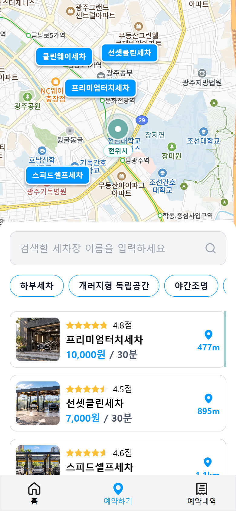
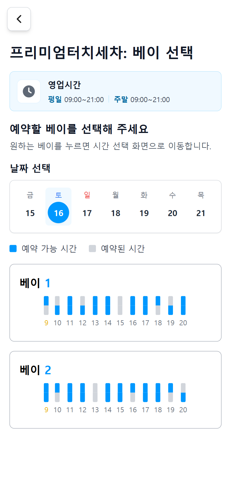
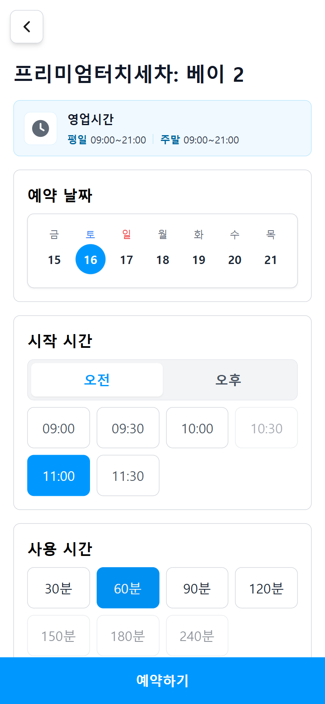
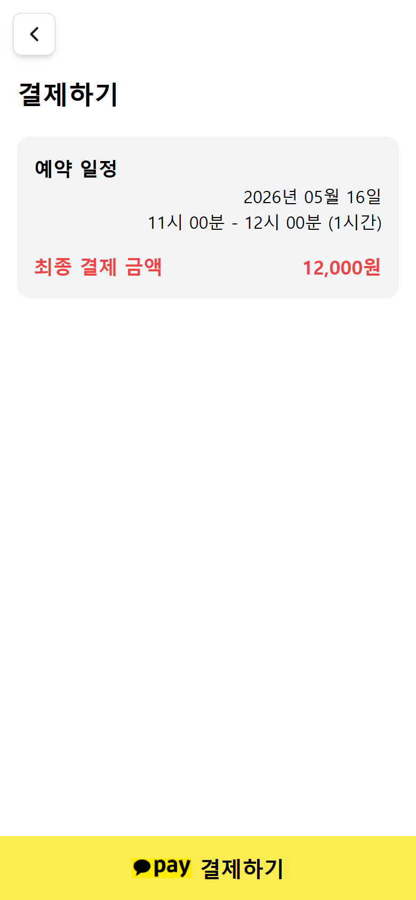

# 뽀득뽀득 — USER 프론트엔드

셀프세차장 탐색부터 베이 선택, 예약 시간 지정, 결제 결과 확인까지 이어지는 모바일 중심 웹 서비스입니다. 카카오 테크 캠퍼스 1기 팀 프로젝트로 시작했고, 이 저장소에는 당시 팀 구현과 2026년 개인 개선이 함께 있습니다.

[](https://github.com/minjuko/ppodeuk-user-frontend/actions/workflows/ci.yml)

## 프로젝트 개요

| 구분 | 내용 |
|---|---|
| 팀 프로젝트 | 2023.09.14–2023.11.17 · 프론트엔드 3명, 백엔드 3명 |
| 팀 당시 담당 | 사용자 예약 흐름, API 연동, 세차장 상세·리뷰·지도 UI 일부 |
| 개인 개선 | 2026년 예약 상태·시간 규칙, 인증·결제 오류 경계, 테스트·CI, 반응형·접근성, 재현 문서 보완 |
| 팀 성과 | 카카오 테크 캠퍼스 1기 신규 서비스 개발 프로젝트 대상 |

팀 백엔드와 사업자용 서비스는 별도 저장소의 구현입니다. 세부 기여와 검증 경계는 [시스템 구조](docs/architecture.md)와 [PP10 Repository 감사](docs/pp10-repository-audit.md)를 참고하세요.

## 주요 기능 및 화면

<table>
  <tr>
    <td width="50%" align="center" valign="top"><br /><sub>주변 세차장 탐색</sub></td>
    <td width="50%" align="center" valign="top"><br /><sub>베이 선택</sub></td>
  </tr>
  <tr>
    <td width="50%" align="center" valign="top"><br /><sub>날짜·시간 선택</sub></td>
    <td width="50%" align="center" valign="top"><br /><sub>결제 진행</sub></td>
  </tr>
</table>

## 기술 스택

- **화면:** React 18, JavaScript, Vite, Tailwind CSS, React Router
- **상태와 API:** Redux Toolkit, Redux Persist, TanStack Query, Axios, REST API
- **인증·지도:** 서버 발급 Bearer 토큰, Kakao Maps JavaScript SDK
- **검증:** Vitest, Testing Library, Playwright, axe-core, MSW, ESLint, TypeScript 검사
- **서버 연동 대상:** Spring Boot, MariaDB (별도 백엔드 저장소)

## 담당 역할 및 핵심 구현

- **예약 의존 상태:** 세차장·베이·날짜·시각이 바뀔 때 무효가 된 하위 선택과 결제 TID를 초기화합니다. URL의 식별자와 저장된 예약 상태도 동기화합니다.
- **예약 시간:** 영업시간, 현재 시각, 기존 예약을 바탕으로 예약 슬롯을 계산합니다. 예약 구간은 `[시작, 종료)`로 비교해 겹침은 막고 바로 이어지는 예약은 허용합니다.
- **결제 경계:** 가격 응답의 기본 형식, 결제 준비의 TID, redirect URL, callback 값, 승인 응답을 확인합니다. 승인 요청 중 UI 중복 입력을 막고 승인 실패 시 예약 선택은 보존합니다.
- **인증·오류:** 서버 발급 Authorization 값을 전달하며 401이면 token과 인증 상태를 정리하고, 5xx·네트워크 오류는 token을 보존해 재확인 안내로 보냅니다. 토큰 저장 방식의 보안 한계는 감사 문서에 기록했습니다.
- **모바일·접근성:** 검색 목록 바텀시트는 터치 핸들과 키보드 버튼으로 열고 닫습니다. Playwright에서 대표 viewport, 주요 흐름과 axe WCAG 2.1 A/AA 자동 검사를 확인합니다.

프론트엔드 검증은 서버의 가격 재계산, 예약 동시성, 결제 승인 멱등성, PG 운영 허용 URL 정책을 대신하지 않습니다. 인증·결제와 UI 테스트 한계는 [감사 기록](docs/pp10-repository-audit.md)에 정리했습니다.

## 테스트 및 검증

| 확인 항목 | 결과 |
|---|---|
| Vitest | **39개 파일, 165개 테스트 통과** |
| Playwright | **Chromium 11개 테스트 통과** |
| axe-core | 예약·결제 주요 화면의 WCAG 2.1 A/AA 규칙 자동 검사 통과 |
| GitHub Actions | 최종 PP10 **#80 성공** — [CI 실행 내역](https://github.com/minjuko/ppodeuk-user-frontend/actions/workflows/ci.yml) |
| Production dependency audit | **취약점 0건** (`npm audit --omit=dev`) |
| 전체 dependency audit | **63건 잔존** — 개발 의존성 트리; 상세 목록은 [PP10 감사](docs/pp10-repository-audit.md) |

Playwright E2E는 빌드된 프론트엔드와 MSW fixture를 사용하는 브라우저 테스트입니다. 실제 운영 백엔드나 KakaoPay에 요청하지 않으며, 운영 PG 승인·백엔드 통합 E2E 결과로 해석하면 안 됩니다. axe 자동 검사 통과도 실제 기기 및 스크린리더 전수 검증을 뜻하지 않습니다.

이미지 용량은 106,998B에서 66,413B로 37.9% 감소했습니다. 과거 로컬 Lighthouse 측정에서는 Performance 88→91, LCP 3,578→3,331ms였으며 현재 운영 성능을 보장하지 않습니다.

## 실행 방법

Node.js 22.20.x와 npm 10.9.x를 사용합니다.

```bash
npm ci
npm run dev
```

`VITE_API_BASE_URL` 등 `VITE_` 접두 환경변수는 빌드 결과에 포함될 수 있어 비밀값을 넣으면 안 됩니다. 실제 API 모드는 로컬 백엔드 주소와 별도 지도 JavaScript 키 설정이 필요합니다. 백엔드 없이 화면을 확인하려면 다음 데모 명령을 사용합니다.

```bash
npm run dev:mock
npm run build:demo:local
npm run preview:demo
```

MSW 데모 계정·fixture와 데모 결제는 로컬 확인용이며 실제 예약이나 결제가 발생하지 않습니다. 전체 로컬 스택은 [재현 안내](docs/local-reproduction.md)를 참고하세요.

주요 검사 명령:

```bash
npm run lint
npm run typecheck
npm test -- --reporter=dot
npm run build:e2e
npm run test:e2e
npm run build
node scripts/verify-production-bundle.mjs
npm audit --omit=dev
```

## 관련 문서

- [시스템 구조와 실행 모드](docs/architecture.md)
- [예약·결제 안정화 설계](docs/refactoring.md)
- [로컬 전체 스택 재현](docs/local-reproduction.md)
- [배포·운영 안내](docs/deployment-operations.md)
- [PP10 Repository·보안 감사](docs/pp10-repository-audit.md)

관련 저장소: [사업자용 프론트엔드](https://github.com/minjuko/ppodeuk-owner-frontend) · [백엔드](https://github.com/minjuko/ppodeuk-backend)
