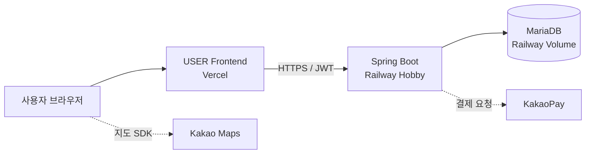

# 시스템 구조와 실행 모드

## 프로젝트 범위

이 저장소는 뽀득뽀득의 사용자용 React 프론트엔드입니다. 2023년 팀 프로젝트에서 사용자 예약 흐름을 중심으로 구현했고, 프로젝트 이후 개인 개선에서는 예약 상태와 시간 규칙, 결제 결과 처리, 인증 예외, 배포 및 재현 환경을 보완했습니다. 팀 백엔드와 사업자용 프론트엔드 전체를 개인 구현으로 표현하지 않습니다.

## 운영 구조

운영 프론트엔드는 실제 백엔드 API를 호출합니다. Railway 백엔드와 MySQL은 2026-10-19 확인 당시 Serverless가 꺼져 있었고 두 서비스 모두 Online이었습니다. 사용량과 서비스 상태는 변하므로 [배포·운영 안내](deployment-operations.md)의 확인 절차를 따릅니다.

## 프론트엔드 데이터 경계

| 데이터 | 소유 위치 | 사용 기술 |
|---|---|---|
| 현재 화면의 날짜·시각·이용 시간 | 화면 컴포넌트 | React local state |
| 여러 예약 경로가 공유하는 선택과 결제 상태 | client state | Redux Toolkit / Redux Persist |
| 세차장·Bay·예약 현황 등 서버 원본 | server state | TanStack Query |
| 화면 이동과 경로 식별자 | router | React Router |
| API 통신 및 JWT 전달 | API layer | Axios instance / interceptor |

서버가 원본인 조회 데이터와 사용자가 예약 과정에서 임시로 선택한 상태를 분리합니다. 세차장·Bay 등 상위 조건이 바뀌면 기존 예약 조회와 결제 식별값을 무효화하고, 날짜가 바뀌면 시작 시각과 이용 시간을 초기화합니다.

## 실행 모드

### 실제 API 연동

일반 `dev` 및 운영 빌드는 Vite 환경변수의 API 주소로 실제 Spring Boot API를 호출합니다. 운영 KakaoPay 승인 E2E는 검증하지 않았습니다.

### Mock 데모

`VITE_DEMO_MODE=true`인 `npm run dev:mock`에서만 MSW worker를 동적으로 시작합니다. 데모 API는 메모리 seed를 사용하며 새로고침하면 초기화됩니다. 등록되지 않은 `/api/*` 요청은 실패 처리해 Mock 실행 중 실 API로 조용히 빠져나가지 않게 합니다. 데모 결제는 실제 결제가 아닙니다.

### 로컬 전체 스택

USER 프론트를 `VITE_DEMO_MODE=false`로 실행하고 `ppodeuk-backend`의 `local` 프로필 및 로컬 MariaDB에 연결합니다. local 프로필의 결제 구현은 예약·DB 저장 검증용이며 실제 KakaoPay와 분리돼 있습니다. 정확한 실행 순서와 환경변수는 [로컬 전체 스택 재현](local-reproduction.md)을 참고합니다.

## 결제 및 예약 검증 경계

- 프론트엔드는 현재 조회 결과를 기반으로 유효하지 않은 시간 조합을 미리 비활성화합니다.
- 시간 계산은 순수 함수로 분리해 영업 경계, 기존 예약과의 겹침, 인접 예약, 당일 과거 시간 등을 독립 검증합니다.
- 백엔드는 요청 시점에 예약 가능 여부와 금액을 최종 검증해야 합니다. 프론트엔드 사전 검사는 동시 요청에 대한 데이터 무결성을 보장하지 않습니다.
- 결제 redirect의 ready, callback, approve를 하나의 상태 흐름으로 처리하고 잘못된 callback 및 중복 승인을 방어합니다.
- 운영 결제 E2E, DB 수준의 예약 동시성 제어, 외부 결제 성공 뒤 예약 저장 실패의 보상 처리는 검증 범위에 포함하지 않습니다.
